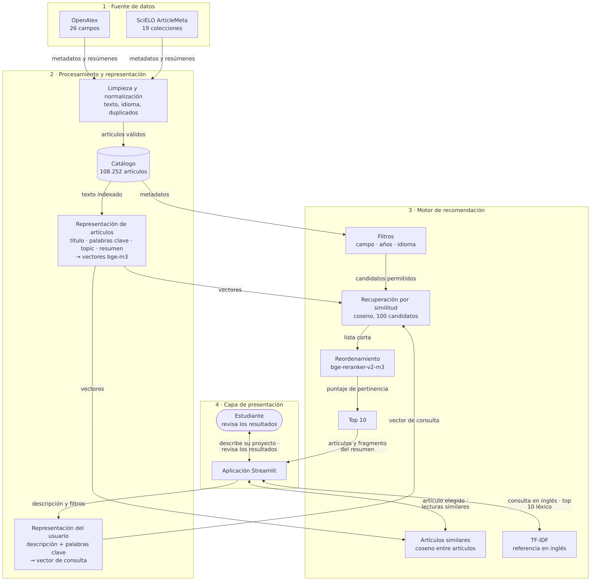

# Ciencia a tu tesis: sistema recomendador de artículos científicos para proyectos de grado y tesis

**Curso:** Sistemas Recomendadores, Universidad Icesi
**Grupo 8:** Sebastian Erazo Ochoa, Ricardo Andrés Chamorro Martinez, Juan Camilo Muñoz Barco

---

# Parte 1. Propuesta del sistema recomendador

## 1.1 Contexto de aplicación

El sistema se ubica en el dominio de la educación superior, en la etapa en que un estudiante formula o desarrolla su proyecto de grado o su tesis. En ese momento necesita encontrar artículos que le permitan conocer los antecedentes del tema y los métodos que otros investigadores ya usaron. La búsqueda suele tomar mucho tiempo, sobre todo cuando el problema todavía no está delimitado o cuando el estudiante no conoce el vocabulario técnico del área: un buscador por palabras clave exige saber de antemano cómo se llama lo que se busca.

Ciencia a tu tesis recomienda artículos a partir de una descripción libre del proyecto, escrita en español o en inglés. Un sistema recomendador es adecuado para este problema por tres razones. Primero, la necesidad del estudiante se expresa mejor como una descripción de lo que quiere investigar que como una consulta exacta. Segundo, la oferta es muy grande y heterogénea, y el estudiante necesita una lista corta y priorizada, no un listado exhaustivo. Tercero, la recomendación puede hacerse desde la primera consulta, comparando el contenido del proyecto con el contenido de los artículos, sin depender de que otros usuarios hayan usado el sistema antes.

El sistema ordena por afinidad temática. No juzga la calidad científica de los artículos ni reemplaza la lectura crítica: su propósito es facilitar la búsqueda inicial y ayudar a priorizar las lecturas para construir los antecedentes y el marco teórico.

## 1.2 Usuarios y elementos a recomendar

**Usuarios.** Estudiantes universitarios que formulan o desarrollan un proyecto de grado o una tesis. Algunos tienen una idea general del tema; otros ya tienen una pregunta de investigación definida. Interactúan con la plataforma escribiendo una descripción de su proyecto, sus objetivos o su pregunta, y pueden agregar palabras clave y restringir la búsqueda por disciplina, periodo de publicación e idioma. A partir de un resultado pueden pedir artículos similares. El sistema no necesita cuentas ni historial: el perfil del estudiante es la descripción de su proyecto.

**Elementos.** Artículos científicos publicados entre 2016 y 2025, con los siguientes atributos:

| Atributo | Uso en el sistema |
|---|---|
| Título | Representación del artículo y presentación del resultado |
| Resumen | Representación del artículo; fuente del fragmento que se muestra junto a cada resultado |
| Palabras clave | Representación del artículo |
| Topic | Representación del artículo; tema fino asignado por OpenAlex |
| Campo | Filtro por disciplina (26 campos de OpenAlex y 9 categorías de SciELO) |
| Año de publicación | Filtro por periodo |
| Idioma | Filtro por idioma; se detecta en el resumen |
| Autores, revista, fuente, DOI y enlace | Presentación del resultado y deduplicación |

## 1.3 Estrategias de recomendación

**Filtrado basado en contenido (estrategia principal).** El sistema compara la descripción del proyecto con el texto de cada artículo (título, palabras clave, topic y resumen) y recomienda los más afines. Es la estrategia que mejor se ajusta al problema: los artículos tienen un contenido textual rico, el estudiante expresa su necesidad en texto, y la recomendación funciona desde el primer uso sin datos de otros usuarios. Además, permite mostrar por qué se recomienda cada artículo: el sistema señala la oración del resumen más cercana a la consulta.

**Filtros basados en requisitos (complemento).** El estudiante puede limitar los resultados por disciplina, periodo e idioma. Los filtros se aplican antes de comparar el contenido, de modo que el sistema siempre devuelve los artículos más afines dentro de las condiciones elegidas.

**Exploración por artículos similares (complemento).** Desde cualquier resultado, el estudiante puede pedir artículos parecidos a ese artículo. Sigue siendo filtrado basado en contenido, en este caso de artículo a artículo, y permite profundizar en un subtema a partir de una lectura que el estudiante ya juzgó útil.

**Estrategias que no son la base del sistema:**

- **Filtrado colaborativo.** Necesita interacciones (lecturas, valoraciones) de muchos usuarios con preferencias parecidas. El sistema no las tiene al empezar, y en este dominio las necesidades de cada estudiante son muy específicas: dos estudiantes del mismo programa pueden investigar temas sin relación. Además, registrar qué lee cada estudiante plantea problemas de privacidad que el prototipo evita al no guardar consultas ni perfiles.
- **Recomendación por popularidad.** Prioriza los artículos más citados o consultados. La popularidad no garantiza pertinencia para una investigación específica, y favorecería de forma sistemática a los temas y a los idiomas ya dominantes en la literatura. El sistema no la usa en ningún punto del ordenamiento.
- **Enfoque híbrido (ampliación).** Si el sistema acumulara retroalimentación de los estudiantes (por ejemplo, qué artículos marcan como útiles), podría combinarla con el contenido. Se deja como ampliación.

---

# Parte 2. Diseño e implementación del sistema recomendador basado en contenido

## 2.1 Arranque en frío

El sistema enfrenta el arranque en frío en sus dos formas, y el diseño basado en contenido resuelve ambas.

**Usuario nuevo.** Un estudiante que llega por primera vez no tiene historial de lecturas ni valoraciones. El sistema no lo necesita: la descripción del proyecto y las palabras clave cumplen el papel del perfil de preferencias. Funcionan como un formulario de preferencias iniciales escrito en lenguaje natural, que además es más rico que una lista de categorías. El estudiante recibe recomendaciones desde la primera consulta, en español o en inglés.

**Artículo nuevo.** Un artículo recién incorporado no tiene lecturas ni citas, y en un sistema colaborativo nunca sería recomendado. En este sistema basta con limpiar su texto y calcular su vector con el mismo modelo que codifica el resto del catálogo: desde ese momento compite en igualdad de condiciones con los demás artículos.

**Riesgo que persiste.** El arranque en frío de contenido sí existe: si un tema no tiene artículos en el catálogo, ninguna estrategia puede recomendarlos. La evaluación lo mostró con el perfil de agentes de inteligencia artificial en organizaciones (sección 2.3.6), cuyo catálogo tiene pocos artículos sobre el tema. La mitigación es ampliar las fuentes de datos (sección 3.2).

## 2.2 Diagrama del sistema

El diagrama está en [`docs/arquitectura.mmd`](arquitectura.mmd) (Mermaid) y se reproduce a continuación.



### Descripción de los módulos

**1. Fuente de datos.** OpenAlex aporta una muestra estratificada de sus 26 campos académicos y SciELO ArticleMeta una muestra de sus 19 colecciones nacionales y temáticas. Ambas fuentes entregan metadatos y resúmenes; el sistema no descarga el texto completo de los artículos. La descarga es reproducible (semilla fija), se puede reanudar si se interrumpe y guarda los archivos originales por separado.

**2. Procesamiento y representación.** La limpieza normaliza los dos esquemas a uno común, repara problemas de codificación, quita los rótulos y avisos editoriales de los resúmenes, excluye los textos que no describen el artículo, detecta el idioma de cada resumen y elimina duplicados por identificador, DOI y título. El resultado es un catálogo de 108.252 artículos con un manifiesto que registra filtros, conteos y hashes. Cada artículo se representa con el texto `título. palabras clave. topic. resumen`, convertido en un vector por el modelo multilingüe bge-m3. La descripción del estudiante y sus palabras clave se convierten en un vector con el mismo modelo, de modo que ambos quedan en el mismo espacio y pueden compararse aunque estén en idiomas distintos.

**3. Motor de recomendación.** Primero aplica los filtros del estudiante (disciplina, periodo, idioma). Luego compara el vector de la consulta con los vectores de los artículos permitidos por similitud coseno y conserva los 100 más cercanos. Un segundo modelo, bge-reranker-v2-m3, lee la consulta junto con cada uno de esos 100 artículos, les asigna un puntaje de pertinencia y los reordena; el sistema entrega los 10 primeros. El mismo módulo resuelve la exploración por artículos similares, comparando el vector de un artículo elegido con el resto del catálogo, y ofrece TF-IDF como referencia léxica para consultas en inglés.

**4. Capa de presentación.** Una aplicación Streamlit recibe la descripción, las palabras clave y los filtros, y muestra cada resultado con autores, año, campo, fuente, resumen, enlace, puntaje y la oración del resumen más cercana a la consulta. Desde cada resultado el estudiante puede ver artículos similares y volver atrás. También puede guardar artículos durante la sesión y descargar las referencias seleccionadas en formato RIS para importarlas en un gestor bibliográfico. La interfaz advierte que la recomendación es temática, que el catálogo tiene poca literatura en español y que el sistema tiende a priorizar el idioma de la consulta. El estudiante revisa los resultados y decide cuáles le sirven.

## 2.3 Prototipo funcional

### 2.3.1 Dataset: fuente, licencia y características

**Fuentes.** [OpenAlex](https://openalex.org/) (licencia CC0) y la [API ArticleMeta de SciELO](https://github.com/scieloorg/articles_meta/blob/master/docs/source/index.rst) (metadatos abiertos; los términos de reutilización de cada artículo dependen de su revista). La extracción se hizo el 17 de octubre de 2026 y produjo 128.312 registros crudos: 124.775 de OpenAlex y 3.537 de SciELO. Se usan títulos, resúmenes, palabras clave y metadatos.

**Catálogo final.** 108.252 artículos publicados entre 2016 y 2025:

| | Inglés | Español | Total |
|---|---:|---:|---:|
| OpenAlex | 101.713 | 3.020 | 104.733 |
| SciELO | 823 | 2.696 | 3.519 |
| **Total** | **102.536 (94,7 %)** | **5.716 (5,3 %)** | **108.252** |

El número de artículos crece con los años, de 7.861 en 2016 a 14.813 en 2025. Hay 34 categorías de campo: los 26 campos de OpenAlex y 9 categorías propias de SciELO, que no equivalen a los de OpenAlex (una de ellas, Engineering, comparte el nombre).

**Características del catálogo y su influencia en el diseño.** El análisis exploratorio (notebook, sección 3) se hizo sobre los 110.474 artículos que quedan tras los filtros estructurales y antes de limpiar los textos. Cada hallazgo motivó una decisión:

| Característica | Evidencia | Decisión de diseño |
|---|---|---|
| Predominio del inglés y de OpenAlex | 5,8 % de artículos en español y 3,2 % de SciELO antes de limpiar; en física, materiales, química e ingeniería química el español no llega al 1 % | Las consultas de evaluación se estratifican para que el español y SciELO tengan casos suficientes, y las métricas se desglosan por idioma y fuente |
| Textos largos | Mediana de 388 tokens; 19,5 % supera los 512 y 0,67 % los 1.024; el percentil 99 es 938 | El recuperador lee hasta 1.024 tokens; en el índice final solo el 0,63 % de los textos se recorta |
| Resúmenes con rótulos y avisos editoriales | 15.197 empiezan con "Abstract" o "Resumen" (el 81 % de los de SciELO); 796 tienen avisos de derechos de autor; 35 tienen caracteres mal codificados | La preparación quita el rótulo y el aviso y repara la codificación; el aviso se reconoce por su forma editorial para no recortar artículos cuyo tema es el derecho de autor |
| Resúmenes que no describen el artículo | 21 portadillas editoriales y 73 resúmenes compartidos por varios artículos (descripciones de revistas), todos de OpenAlex | Se excluyen del catálogo |
| Idioma mal etiquetado | El 12,4 % de los artículos declarados en español (795 de 6.434) tiene el resumen en otro idioma, sobre todo en inglés; OpenAlex declara el idioma del título | El idioma pasa a ser el detectado en el resumen y se excluyen los resúmenes que no están en español ni en inglés, porque el filtro de idioma y las métricas por idioma dependen de este campo |
| Términos ambiguos | "Agente" aparece sobre todo en farmacología (9,5 %), inmunología (8,9 %) y química (7,1 %); "arquitectura" en computación (8,4 %), ciencias exactas, ingeniería y humanidades; "red" en computación (24,9 %) y neurociencia (13,1 %) | Tres de los perfiles de verificación humana se diseñan alrededor de estos términos |

La limpieza modificó el texto de 16.462 artículos, corrigió el idioma de 846 y excluyó 2.222: 2.080 con el resumen en otro idioma, 73 con el resumen compartido, 48 que quedaron con menos de 80 palabras y 21 portadillas. Las exclusiones se concentran en ciencias sociales (6,8 % del campo), administración (6,8 %) y humanidades (6,6 %), frente a una mediana de 1,3 % por campo; es un sesgo de selección que se discute en la Parte 3. En el catálogo final, el español no llega al 1 % en cinco campos: física (0,31 %), materiales (0,48 %), ingeniería química (0,62 %), química (0,63 %) y bioquímica (0,89 %).

### 2.3.2 Representación y criterio de similitud

**Representación de los artículos.** El texto indexado es `título. palabras clave. topic. resumen`. Las palabras clave y el topic resumen el tema con términos que el resumen a veces no usa; el campo no se incluye porque es una categoría amplia que no distingue artículos del mismo campo, y se reserva para el filtro. El texto se codifica con [`BAAI/bge-m3`](https://huggingface.co/BAAI/bge-m3) en modo denso: un vector de 1.024 dimensiones normalizado por artículo, con una ventana de 1.024 tokens.

**Representación del usuario.** La consulta es la descripción del proyecto seguida de `". Palabras clave: "` y las palabras clave, si el estudiante las escribe. Se codifica con el mismo modelo, que representa el español y el inglés en un mismo espacio.

**Criterio de similitud.** El sistema calcula la similitud coseno exacta entre la consulta y cada artículo que cumple los filtros y conserva los 100 más cercanos. Después, [`BAAI/bge-reranker-v2-m3`](https://huggingface.co/BAAI/bge-reranker-v2-m3) lee la consulta y cada candidato juntos (hasta 512 tokens) y les asigna un puntaje de pertinencia; se entregan los 10 primeros. No hay umbral: los puntajes del reordenador no están calibrados entre consultas, y un corte fijo dejaba listas incompletas o vacías (por ejemplo, 2 de 10 resultados para una consulta sobre contaminantes en ríos andinos). El puntaje que se muestra ordena los resultados; no es una probabilidad ni una medida de calidad.

**Artículos similares.** Coseno entre el vector del artículo elegido y los del catálogo, con los mismos filtros de la búsqueda y excluyendo el artículo de referencia y sus duplicados.

**Referencia.** TF-IDF de unigramas y bigramas, sin palabras vacías del inglés y con 30.000 términos, sobre los artículos en inglés.

### 2.3.3 Cómo ejecutarlo

Requisitos: Python 3.11 o 3.12. Con GPU, los modelos se cargan en media precisión (fp16) y caben en 4 GB de memoria.

```bash
python -m pip install -r requirements-lock.txt
python scripts/download_data.py   # descarga y construye el catálogo
python scripts/build_index.py     # vectores bge-m3 (unos 70 minutos en GPU), TF-IDF y reordenador
streamlit run app.py
```

El código está comentado y el notebook [`notebooks/01_recomendador_explicado.ipynb`](../notebooks/01_recomendador_explicado.ipynb) explica cada etapa con su resultado. El README describe cómo reproducir la evaluación. Los 43 tests automatizados (`pytest -q`) cubren la limpieza, el motor, las métricas, la exploración por artículos similares y la navegación de la aplicación.

### 2.3.4 Ejemplo de perfil de usuario

Perfil P03 de la verificación humana: *"Quiero investigar el uso de aprendizaje automático para predecir la generación de energía solar y eólica y mejorar la operación de redes eléctricas."* Top 5 del sistema, con la calificación ciega del evaluador (0 no pertinente, 1 parcial, 2 directa):

| # | Artículo | Año | Calificación |
|---|---|---|---|
| 1 | Is artificial intelligence an impediment or an impetus to renewable energy investment? Evidence from China | 2025 | 0 — estudio econométrico de inversión; no usa aprendizaje automático para pronosticar |
| 2 | Applications of machine learning and artificial intelligence in the oil and gas industry: a study of keywords and research results | 2025 | 1 — comparte el método en otro sector energético |
| 3 | Comparative Analysis of Machine Learning Models for Day-Ahead Photovoltaic Power Production Forecasting | 2021 | 2 |
| 4 | Deep Learning Applications in Energy Consumption Optimization: A Comprehensive Analysis | 2025 | 1 |
| 5 | An Approach to Optimized the Output Power of Photovoltaic System Using Artificial Neural Networks | 2024 | 1 |

Cuatro de los cinco resultados son al menos parcialmente pertinentes y uno es un antecedente directo. El ejemplo también muestra la principal debilidad que encontró la evaluación: el primer puesto lo ocupa un artículo que comparte los conceptos de la consulta (inteligencia artificial, energías renovables) pero no su objetivo.

### 2.3.5 Evaluación

**Tarea y protocolo.** Dada la descripción de un proyecto, el sistema devuelve 10 artículos. Las métricas y sus metas se fijaron antes de comparar configuraciones y no se cambiaron al conocer los resultados. Toda la evaluación se hizo sin filtros, como una búsqueda abierta en la aplicación.

| Métrica | Cómo se obtiene | Para qué sirve | Meta |
|---|---|---|---|
| **MRR@10, ítem conocido** (principal) | Para cada artículo de origen se redacta una descripción de proyecto que ese artículo respondería; se registra la posición en que aparece dentro del top 10 | Mide si el sistema encuentra el artículo que corresponde a una descripción de proyecto | La configuración elegida supera a la de referencia por ≥ +0,05, con p < 0,05 |
| Recall@10, ítem conocido | Proporción de consultas cuyo artículo de origen aparece en el top 10 | Mide si ese artículo aparece en lo que ve el estudiante | ≥ 0,60 (orientativa) |
| Brecha de MRR@10 entre español e inglés | Diferencia absoluta entre el MRR@10 de las consultas en cada idioma | Mide si las consultas en español funcionan igual de bien | ≤ 0,10 |
| Precision@10 por topic | Un resultado es pertinente si comparte el topic de OpenAlex con el artículo de origen | Mide la coherencia temática del top 10 | ≥ +0,05 frente a la referencia |
| P@5 y nDCG@5 con juicio humano | Calificación ciega 0/1/2 de perfiles bilingües; el nDCG ideal se calcula con todos los juicios del perfil | Comprueba que los resultados automáticos se traducen en utilidad | P@5 (grado ≥ 1) ≥ 0,70 |
| Exposición por idioma y fuente | Proporción de artículos en español y de SciELO en el top 10, sin contar el artículo de origen, frente a su proporción en el catálogo | Evidencia para el análisis de sesgos | Se reporta |
| Diversidad (ILD@10) | 1 − coseno medio entre los pares del top 10, con los vectores bge-m3 para todas las configuraciones | Evidencia de sobreespecialización | Se reporta |

El ítem conocido y el topic son aproximaciones automáticas: una consulta tiene un solo artículo de origen aunque el catálogo contenga otros igual de pertinentes, y el topic de OpenAlex se asigna automáticamente. Por eso se incluye la verificación humana.

**Conjuntos de evaluación.**

- *Ítem conocido* (`data/evaluation/known_item.jsonl`): 200 artículos de origen seleccionados con semilla 42 y estratificados por fuente, idioma y campo: 156 de OpenAlex en inglés (6 por campo), 4 de SciELO en inglés, 20 de OpenAlex en español y 20 de SciELO en español. Así hay 40 orígenes en español y 24 de SciELO, cuando un muestreo proporcional daría unos 11 y 7. Se excluyeron como origen los artículos con texto residual de plantilla, sin topic, con un título casi duplicado (por ejemplo "Parte 1" y "Parte 2") o que no reportan una investigación (notas editoriales, reseñas). Para cada uno se redactó a mano una descripción de proyecto de grado de 2 a 4 oraciones; la mitad de cada grupo está en español y la otra en inglés, sin importar el idioma del artículo. Ninguna descripción comparte una frase literal de cinco palabras con su artículo, y en promedio reutilizan 0,43 términos distintivos (máximo 3; ninguno en 138 de las 200).
- *Verificación humana* (`data/evaluation/topics.jsonl`): 10 perfiles redactados en español y en inglés. Seis cubren temas con distinta cobertura en el catálogo; tres se diseñaron alrededor de términos ambiguos (agentes de inteligencia artificial, arquitectura de software y redes neuronales) y uno alrededor de un tema con más literatura en SciELO (gestión comunitaria del agua). Para cada perfil e idioma se unieron el top 5 de la referencia y el de la configuración elegida, se mezclaron y se ocultó su origen: 127 artículos calificados por un integrante del grupo siguiendo una [guía](guia_calificacion.md) con ejemplos de cada grado.

**Configuraciones comparadas.** Cada una cambia un solo elemento respecto de la anterior:

| | Recuperador | Reordenador | Lista corta | s/consulta |
|---|---|---|---|---:|
| **A** (referencia) | multilingual-e5-small, 512 tokens | mMARCO MiniLM, 384 tokens | 500 | 1,47 |
| **B** | bge-m3, 1.024 tokens | — | — | 0,05 |
| **C** (elegida) | bge-m3, 1.024 tokens | bge-reranker-v2-m3, 512 tokens | 100 | 3,14 |
| **D** | bge-m3, 1.024 tokens | bge-reranker-v2-m3, 1.024 tokens | 100 | 3,81 |
| **E** | bge-m3 + índice léxico bilingüe (fusión RRF) | bge-reranker-v2-m3, 512 tokens | 100 | 3,58 |

Tiempos medidos en una GPU RTX 3050 de 4 GB.

**Resultados automáticos (200 consultas).**

| | MRR@10 | Recall@10 | Brecha es/en | P@10 por topic | ILD@10 |
|---|---:|---:|---:|---:|---:|
| A | 0,640 | 0,81 | 0,048 | 0,306 | 0,451 |
| B | 0,730 | 0,88 | 0,050 | 0,410 | 0,387 |
| **C** | **0,900** | **0,97** | 0,063 | **0,490** | 0,390 |
| D | 0,886 | 0,97 | 0,068 | 0,483 | 0,390 |
| E | 0,885 | 0,95 | 0,070 | 0,480 | 0,398 |

Prueba de aleatorización pareada de Fisher (`ranx.compare`, 100.000 permutaciones; los p-valores tienen un error de Monte Carlo de alrededor de ±0,001):

| Comparación | Δ MRR@10 | p | Δ Recall@10 | p |
|---|---:|---:|---:|---:|
| B frente a A | +0,091 | ≈ 0,007 | +0,07 | ≈ 0,03 |
| **C frente a A** | **+0,260** | **< 0,00001** | +0,16 | < 0,00001 |
| C frente a B | +0,170 | < 0,00001 | +0,09 | < 0,00001 |
| D frente a C | −0,014 | ≈ 0,05 | 0,00 | 1,0 |
| E frente a C | −0,015 | ≈ 0,13 | −0,02 | ≈ 0,12 |

Las métricas propias (MRR, Recall, nDCG con el ideal calculado desde todos los juicios, ILD) tienen tests con valores conocidos y coinciden con `ranx` al cuarto decimal.

**Desglose de C frente a A (MRR@10).**

| Grupo | Consultas | A | C |
|---|---:|---:|---:|
| Consulta en inglés | 100 | 0,616 | 0,931 |
| Consulta en español | 100 | 0,664 | 0,868 |
| Inglés → artículo en inglés | 80 | 0,588 | 0,936 |
| Inglés → artículo en español | 20 | 0,725 | 0,912 |
| Español → artículo en inglés | 80 | 0,684 | 0,835 |
| Español → artículo en español | 20 | 0,580 | 1,000 |
| Origen OpenAlex | 176 | 0,640 | 0,889 |
| Origen SciELO | 24 | 0,640 | 0,979 |

**Por qué se eligió C.** El análisis de errores de cada configuración guió el siguiente paso:

- En **A**, de los 38 fallos, 13 se perdían en la recuperación (el artículo no entraba entre los 500 candidatos) y 25 en el reordenamiento: en 17 de ellos e5 ya tenía el artículo en su top 10 y el reordenador lo sacaba. El 79 % de los pares consulta-artículo superaba los 384 tokens que lee ese reordenador.
- En **B**, el recuperador bge-m3 coloca el artículo de origen dentro del top 100 en el 98 % de las consultas (ampliar a 200 no agrega ninguno), pero falla sobre todo entre idiomas (MRR de 0,579 de inglés a español y 0,674 de español a inglés). Eso justificó un reordenador multilingüe sobre 100 candidatos: **C** sube esos cruces a 0,912 y 0,835.
- En **C**, los pares de más de 512 tokens tenían un MRR menor (0,885 frente a 0,942) y concentraban los fallos del reordenador. **D** amplió la lectura a 1.024 tokens para comprobarlo: no mejoró (−0,014, p ≈ 0,05) y fue un 21 % más lento. Los pares largos son más difíciles por sí mismos. Se descartó.
- **E** fusiona la lista densa con un índice léxico bilingüe. No mejoró (−0,015, p ≈ 0,13) y perdió en las búsquedas entre idiomas (0,862 de inglés a español y 0,812 de español a inglés), porque el índice léxico solo encuentra palabras del mismo idioma de la consulta. Además acentuó el sesgo de idioma (sección 3.1). Se descartó.

**Análisis de errores de tres consultas.**

1. *Consulta en inglés sobre un compuesto de dos semiconductores que degrada colorantes con luz (artículo de origen en inglés).* C no encuentra el artículo de origen (queda en el puesto 347 de la recuperación), pero sus tres primeros resultados son heterouniones fotocatalíticas del mismo topic, que en el catálogo tiene 798 artículos. El error es de la aproximación del ítem conocido, no del sistema.
2. *Consulta en español sobre virus del ganado que bloquean los sensores celulares de material genético viral (artículo de origen en inglés).* C devuelve artículos sobre antagonistas del interferón del SARS-CoV-2 y sobre sensores de ARN viral: el mismo mecanismo con otro huésped. El artículo de origen estaba en el puesto 92 de la recuperación y el reordenador no lo subió. Es un error del modelo: la consulta en español no le da suficiente peso al huésped y a la enfermedad frente al mecanismo.
3. *Consulta en español sobre producción de hidrógeno con luz usando catalizadores de metales no nobles (artículo de origen en inglés).* A pone primero un catalizador de iridio para metanol, otro tema; B encuentra el artículo en el puesto 2 y C en el 1. Muestra lo que aportan el recuperador multilingüe y el reordenador en una búsqueda entre idiomas.

**Verificación humana (127 juicios, 20 consultas).**

| | P@5 (grado ≥ 1) | P@5 (grado 2) | nDCG@5 |
|---|---:|---:|---:|
| A | 0,81 | 0,39 | 0,673 |
| **C** | **0,82** | 0,39 | 0,629 |
| C − A (p, aleatorización pareada) | +0,01 (≈ 0,94) | 0,00 (≈ 0,95) | −0,044 (≈ 0,28) |

| nDCG@5 por idioma de la consulta | A | C |
|---|---:|---:|
| Inglés | 0,688 | 0,681 |
| Español | 0,659 | 0,577 |

**Las métricas automáticas y las humanas no coinciden.** Según el ítem conocido, C es mucho mejor que A; según el juicio humano, son equivalentes. Hay tres explicaciones:

1. *Miden cosas distintas.* El ítem conocido pregunta si el sistema encuentra un artículo concreto a partir de una descripción detallada, y ahí la lectura fina del reordenador marca la diferencia. Los perfiles humanos describen temas amplios, con muchos artículos pertinentes: las dos configuraciones llegan a una P@5 cercana a 0,8, aunque solo comparten en promedio 1,65 de sus 5 resultados.
2. *La preferencia de C por el idioma de la consulta.* Con consultas en español, el 42 % de las posiciones del top 5 de C son artículos en español, frente al 2 % en A. A veces ayuda: en el perfil de gestión del agua, los artículos en español de C reciben calificaciones de 1 y 2. A veces perjudica: en el de lenguas indígenas, C coloca tres artículos en español calificados con 0. En promedio los artículos en español no reciben peores calificaciones (1,09 frente a 1,11 de los artículos en inglés), pero C pone arriba artículos menos precisos: el primer puesto promedia 1,2 en C y 1,5 en A. Por eso la desventaja se concentra en el nDCG de las consultas en español.
3. *Poca potencia estadística.* Son 20 consultas y un solo calificador, sin medida de acuerdo entre calificadores.

**Cuál conclusión es más confiable.** Para afirmar que C encuentra el trabajo que corresponde a una descripción de proyecto, la evaluación de ítem conocido es la evidencia sólida (200 consultas, p < 0,00001). Para afirmar que C entrega listas más útiles en búsquedas temáticas amplias, la verificación humana es la que mide utilidad y no lo respalda: A y C son equivalentes, y C muestra una desventaja no significativa en el orden de las consultas en español. Este informe solo sostiene la primera afirmación. C se mantiene como sistema final porque así lo establece el criterio fijado de antemano (la métrica principal), y porque cumple la meta de utilidad humana.

**Cumplimiento de las metas.**

| Meta | Resultado | Estado |
|---|---|---|
| MRR@10: C supera a A por ≥ +0,05 con p < 0,05 | +0,260; p < 0,00001 | Cumplida |
| Recall@10 ≥ 0,60 (orientativa) | 0,97 | Cumplida |
| Brecha de MRR@10 entre español e inglés ≤ 0,10 | 0,063 | Cumplida |
| Precision@10 por topic ≥ +0,05 frente a A | +0,184 (0,490 frente a 0,306) | Cumplida |
| P@5 humano (grado ≥ 1) ≥ 0,70 | 0,82 | Cumplida |
| Exposición e ILD | Sección 3.1 | Se reportan |

Los artefactos de la evaluación (métricas, comparaciones, desgloses, exposición, juicios agregados y un manifiesto con modelos, revisiones, parámetros, semilla y hash del catálogo) quedan en `artifacts/`. Una auditoría que recodifica 100 artículos estratificados por fuente e idioma confirmó que los vectores guardados corresponden al catálogo (coseno mínimo de 0,99999).

### 2.3.6 Limitaciones

- **Cobertura.** Hay temas con poca literatura en el catálogo. Los perfiles de agentes de inteligencia artificial y de arquitectura de software están entre los de menor calificación humana en las dos configuraciones (nDCG@5 entre 0,27 y 0,46). El sistema evita los sentidos equivocados de los términos ambiguos, pero no puede recomendar literatura que el catálogo no tiene.
- **Idioma.** El catálogo es 94,7 % inglés, y el reordenador prioriza el idioma de la consulta (sección 3.1).
- **Errores de la recuperación.** En 4 de los 6 fallos de C en el ítem conocido, el artículo de origen quedó fuera de los 100 candidatos (entre los puestos 208 y 347), así que el reordenador nunca lo vio; tres de esos cuatro son consultas en español sobre artículos en inglés.
- **Metadatos.** Solo se usan metadatos y resúmenes. Quedan 56 avisos de derechos de autor incrustados a mitad del texto que la limpieza no recorta para no arriesgar texto útil. El topic de SciELO es la primera palabra clave de la revista, por lo que la métrica por topic solo usa orígenes de OpenAlex (176 de 200). ArticleMeta no informa de manera consistente las retractaciones.
- **Evaluación.** La verificación humana tiene un solo calificador y 20 consultas. Las descripciones de ítem conocido las redactó el grupo, que conocía el sistema.
- **Artículos similares.** La exploración por artículos similares no tiene una evaluación propia con métricas.
- **Actualización.** Agregar artículos exige reconstruir el catálogo y recodificar el índice (unos 70 minutos en una GPU de 4 GB). Cada búsqueda toma unos 3 segundos en GPU.

---

# Parte 3. Análisis de sesgos

## 3.1 Identificación de sesgos

Se usa la clasificación de Friedman y Nissenbaum (1996): sesgos **preexistentes** (vienen de la sociedad o de los datos antes del sistema), **técnicos** (surgen de las decisiones y limitaciones del diseño) y **emergentes** (aparecen con el uso). Para cada uno se indica con qué tipo de la consigna se relaciona (selección, exposición o popularidad) y la evidencia que lo respalda.

### Sesgos preexistentes

**P1. Predominio del inglés en la literatura indexada** *(sesgo de selección)*. El 94,7 % del catálogo está en inglés y el 5,3 % en español. En física, materiales, química, ingeniería química y bioquímica el español no llega al 1 %. Para un estudiante que busca en español, la literatura en su idioma es escasa en esas áreas, y lo que el sistema puede recomendar refleja la composición de las fuentes, no la producción científica real en español.

**P2. Cobertura desigual de OpenAlex y SciELO** *(sesgo de selección)*. OpenAlex aporta el 96,7 % del catálogo y SciELO el 3,3 %, aunque SciELO reúne buena parte de la literatura latinoamericana. La muestra de SciELO es de tres páginas por colección, y sus nueve categorías siguen la clasificación de las revistas, que no equivale a los campos de OpenAlex.

**P3. Exclusión desigual durante la preparación** *(sesgo de selección)*. Al exigir resúmenes en español o inglés se excluyeron 2.080 artículos, sobre todo de ciencias sociales (6,8 % del campo), administración (6,8 %) y humanidades (6,6 %), frente a una mediana de 1,3 %. Son áreas donde se publica más en otros idiomas, como el portugués o el indonesio.

### Sesgos técnicos

**T1. Preferencia del reordenador por el idioma de la consulta** *(sesgo de exposición)*. Sin contar el artículo de origen, con consultas en inglés C muestra artículos en español en la misma proporción del catálogo (5,5 % frente a 5,3 %) y SciELO por debajo (2,5 % frente a 3,3 %). Con consultas en español multiplica el español por 4,2 (22,2 %) y SciELO por 3,1. La verificación humana muestra que eso a veces trae artículos pertinentes y a veces desplaza literatura en inglés más precisa (nDCG@5 de 0,577 en las consultas en español, frente a 0,681 en inglés). La alternativa con índice léxico (E) lo acentuaba (6,2 veces), y por eso se descartó. Es el sesgo con más evidencia del sistema.

**T2. Truncamiento de textos largos** *(sesgo de selección dentro del modelo)*. Un modelo que lee pocos tokens representa peor los artículos largos, que son más frecuentes en OpenAlex en inglés (el 20,2 % supera los 512 tokens, frente al 6,9 % en SciELO en español). En la configuración de referencia se recortaba el 21 % de los textos en la recuperación y la mayoría de los pares en el reordenamiento.

**T3. Categorías y topics no equivalentes** *(sesgo de exposición en los filtros y en la evaluación)*. El filtro por campo mezcla 26 campos de OpenAlex con 9 categorías de SciELO definidas con otro criterio; un estudiante que filtra por "Medicine" no ve los artículos de SciELO clasificados como "Health Sciences". Además, los topics de OpenAlex se asignan automáticamente, y la métrica de coherencia por topic hereda sus errores y no puede contar a SciELO.

**T4. Afinidad confundida con calidad.** El sistema ordena por cercanía temática. Un artículo muy afín puede tener un diseño metodológico débil o pertenecer a una revista de baja calidad; el puntaje no lo distingue.

### Sesgos emergentes

**E1. Sobreespecialización** *(sesgo de exposición)*. Las listas de C son más homogéneas que las de la referencia (ILD@10 de 0,390 frente a 0,451): cuanto más preciso es el sistema, más se parecen entre sí sus resultados. Con el uso, el estudiante puede leer variantes de un mismo subtema y no conocer enfoques vecinos. La exploración por artículos similares puede acentuarlo, porque cada paso se acerca más al artículo elegido.

**E2. Concentración de lecturas** *(relacionado con el sesgo de popularidad)*. El sistema no usa citas ni popularidad, así que no tiene el sesgo de popularidad clásico. Pero si muchos estudiantes con temas parecidos reciben las mismas recomendaciones, esos artículos se leerán y citarán más, y en un sistema que incorporara retroalimentación se volverían populares por haber sido recomendados.

## 3.2 Estrategias de mitigación

| Sesgo | Medida | Actúa sobre | Estado |
|---|---|---|---|
| P1. Predominio del inglés | Ampliar las páginas de SciELO por colección y agregar repositorios latinoamericanos (por ejemplo Redalyc o La Referencia); reportar la cobertura en español por campo | Datos | Propuesta; la cobertura se reporta en la interfaz y en el informe |
| P2. Cobertura de SciELO | Aumentar la muestra de SciELO y estratificarla por categoría; medir la exposición por fuente en cada evaluación | Datos y evaluación | La medición se implementó (`evaluation_exposure.csv`); ampliar la muestra queda propuesto |
| P3. Exclusión por idioma | Admitir resúmenes en portugués, que el modelo multilingüe ya representa, y reportar las exclusiones por campo | Datos | Las exclusiones se reportan en el manifiesto; admitir portugués queda propuesto |
| T1. Preferencia por el idioma de la consulta | Reordenamiento consciente del idioma: reservar dos posiciones del top 10 para el idioma que no es el de la consulta cuando su puntaje esté cerca del décimo resultado, y medir el efecto con el nDCG humano por idioma | Resultado | Propuesta; la interfaz advierte del sesgo |
| T2. Truncamiento | Usar un recuperador con ventana de 1.024 tokens, fijada según los percentiles del texto | Modelo | Resuelto: solo el 0,63 % de los textos se recorta |
| T3. Categorías y topics | Mapear las categorías de SciELO a los campos de OpenAlex con un clasificador sobre el texto; contrastar las métricas por topic con juicio humano | Datos y evaluación | La verificación humana se implementó; el mapeo queda propuesto |
| T4. Afinidad confundida con calidad | Advertir en la interfaz que la recomendación es temática y mostrar la fuente y la revista de cada artículo | Presentación | Implementado |
| E1. Sobreespecialización | Reordenar con MMR los 100 candidatos y ofrecer tres pesos de afinidad (λ=1, 0,7 y 0,5) para controlar la diversidad | Resultado | Implementado en la búsqueda semántica; comparar ILD y pertinencia humana antes de concluir su impacto |
| E2. Concentración de lecturas | Si se incorpora retroalimentación, limitar el peso de la popularidad y vigilar la cobertura del catálogo que llega a recomendarse | Resultado | Propuesta |

Dentro del prototipo se resolvieron el truncamiento, la medición de la exposición por idioma y fuente, la verificación humana como contraste de las métricas automáticas y las advertencias de la interfaz. Las demás medidas quedan descritas para una versión con más datos o con retroalimentación de los usuarios.
MMR ya está disponible como opción en la búsqueda semántica. Su efecto cuantitativo en diversidad (ILD) y pertinencia humana queda pendiente de una evaluación comparativa.

**Trabajo futuro.** Además de las mitigaciones: búsqueda híbrida que no dependa del idioma (por ejemplo, traduciendo la consulta antes de la búsqueda léxica), expansión de consultas, ajuste fino de los modelos con juicios del dominio, más calificadores para medir el acuerdo entre ellos y una evaluación propia de la exploración por artículos similares.

---

# Correspondencia con la rúbrica

| Actividad | Dónde se responde |
|---|---|
| 1.1 Contexto de aplicación | Parte 1, sección 1.1 |
| 1.2 Usuarios y elementos | Parte 1, sección 1.2 |
| 1.3 Estrategias de recomendación | Parte 1, sección 1.3 |
| 2.1 Arranque en frío | Parte 2, sección 2.1; notebook, sección 10 |
| 2.2 Diagrama esquemático | Parte 2, sección 2.2; `docs/arquitectura.mmd` |
| 2.3 Prototipo funcional | Parte 2, sección 2.3; `app.py`, `src/sisreco/`, notebook, README |
| 3.1 Identificación de sesgos | Parte 3, sección 3.1 |
| 3.2 Mitigación de sesgos | Parte 3, sección 3.2 |

# Referencias

- Friedman, B. y Nissenbaum, H. (1996). Bias in computer systems. *ACM Transactions on Information Systems*, 14(3), 330–347.
- Chen, J., Xiao, S., Zhang, P., Luo, K., Lian, D. y Liu, Z. (2024). BGE M3-Embedding: Multi-lingual, multi-functionality, multi-granularity text embeddings through self-knowledge distillation. [arXiv:2402.03216](https://arxiv.org/abs/2402.03216). Modelos: [BAAI/bge-m3](https://huggingface.co/BAAI/bge-m3) y [BAAI/bge-reranker-v2-m3](https://huggingface.co/BAAI/bge-reranker-v2-m3).
- Wang, L. et al. (2024). Multilingual E5 text embeddings: A technical report. [arXiv:2402.05672](https://arxiv.org/abs/2402.05672). Modelo [intfloat/multilingual-e5-small](https://huggingface.co/intfloat/multilingual-e5-small) (configuración de referencia).
- Bonifacio, L. et al. (2021). mMARCO: A multilingual version of the MS MARCO passage ranking dataset. [arXiv:2108.13897](https://arxiv.org/abs/2108.13897). Modelo [cross-encoder/mmarco-mMiniLMv2-L12-H384-v1](https://huggingface.co/cross-encoder/mmarco-mMiniLMv2-L12-H384-v1) (configuración de referencia).
- Bassani, E. (2022). ranx: A blazing-fast Python library for ranking evaluation and comparison. *ECIR 2022*. [Documentación](https://amenra.github.io/ranx/).
- Smucker, M., Allan, J. y Carterette, B. (2007). A comparison of statistical significance tests for information retrieval evaluation. *CIKM 2007*.
- Cormack, G., Clarke, C. y Büttcher, S. (2009). Reciprocal rank fusion outperforms Condorcet and individual rank learning methods. *SIGIR 2009* (fusión usada en la configuración E).
- Carbonell, J. y Goldstein, J. (1998). The use of MMR, diversity-based reranking for reordering documents and producing summaries. *SIGIR 1998*.
- [OpenAlex: atributos de trabajos](https://help.openalex.org/data/works/attributes/) y [campos académicos](https://help.openalex.org/data/fields/).
- [SciELO ArticleMeta REST API](https://github.com/scieloorg/articles_meta/blob/master/docs/source/index.rst).
